<div align="center">

# 📚 bth: book translation harness

**Translate whole books with AI agents and keep them consistent from page one to the index.**

Any language pair · Any agent runtime · EPUB in, EPUB out · You can correct anything, down to a single sentence


</div>

---

Ask an LLM to translate a 300-page book chunk by chunk and you get **three spellings of the same name**, **broken footnote links**, **an untranslated index**, and **no way to find the paragraph a reader complained about**.

`bth` splits the job in two. **Agents do the language work:** the translation spec, name verification, translation, review and fixes. **The harness does the rest:** it extracts the book, plans parallel work, validates and merges every output, runs the checks, and builds the finished EPUB.

```text
$ bth next books/my-book
{ "action": "dispatch", "phase": "translate", "pending": 64, "workers": 10 }
```

Your agent starts 10 parallel workers. Every output is checked before it is merged. When `bth next` says `done`, you have an EPUB, a side-by-side bilingual review page, and a QA report.

**You keep the final word.** Change a term, adjust the voice, or rewrite a sentence. `bth` redoes only the paragraphs your change affects, and it never overwrites your edits.

## ✨ What it does

| | |
|---|---|
| 🧭 **Spec before translation** | Before any translating, an agent writes a style guide (book background and a summary of every chapter), a glossary that handles words with several senses (*policy*: 策略 in RL, 政策 in public affairs), and example translations that set the voice. |
| 🔎 **Online name verification** | Agents look up established renderings of people, works and organisations: Wikidata first, then national sources. They also check whether the book already has a published translation, whose title and terms then take priority. |
| ⚡ **Parallel and safe** | Work is claimed atomically, so N workers can run at once. Each output is validated before it is merged under a lock. Bad output is sent back to the same worker with the exact errors. |
| 🧪 **Two layers of QA** | **Script checks:** placeholders, numbers (`3,000,000 = 300万 = 3 million`), glossary terms and forbidden variants, punctuation, name consistency, length outliers. **AI review:** a different worker reports issues by severity (critical / major / minor) without editing anything; a fixer then makes minimal edits, and every change is logged. |
| 🖼️ **Text in images too** | Charts, diagrams and tables saved as pictures are not skipped. Agents that can view images locate and transcribe every label; the labels are translated, checked and reviewed like the rest of the book, then **set back into the image in place of the original text**. Prefer your own redrawn figure? Drop it in and it replaces the original. |
| 🩹 **One policy for errors in the original** | Wrong names, dates or titles in the book are kept, fixed silently when obvious, or fixed with a translator's note: your choice in `book.toml`, applied the same way by every agent. With notes, the EPUB gets a translator's errata page that links back to each corrected passage. |
| 📜 **Quotations checked at the source** | When a book quotes an author who wrote in another language, agents look up the original wording and cite it. Verified quotations use the author's own words; unverified ones are marked, never passed off as the original. Titles, quotations and repeated passages are kept identical everywhere they recur. |
| 🎨 **Original layout preserved** | Translations are written back into the source XHTML. CSS, images, footnote links, index locators and the navigation all survive. TXT, HTML and PDF sources get a clean generated EPUB. |
| 🌍 **Language rules in data, not code** | Language packs (`bth/langs/*.toml`) and pair profiles (`bth/pairs/*.md`) cover punctuation, quotes, number formats, transliteration, right-to-left and vertical layout, and navigation labels. To add a language, add a file. |
| ✍️ **You stay in control** | Correct the translation at any level: fix a term in the glossary, reshape the voice through the style guide and examples, or rewrite a sentence directly. `bth` finds the paragraphs affected and redoes only those. Your edits are locked and **never overwritten**. The QA report and bilingual page point you to the passages most worth your attention. |
| 🧾 **Every paragraph traceable** | Every paragraph has a stable ID (`ch05-p0031`), plain-text files and git commits for each phase. A reader reports an error, you fix that one paragraph, rebuild, and release again. |

## 🔁 The pipeline

```mermaid
flowchart LR
    SRC[/"📖 Source<br/>EPUB · HTML · TXT · PDF"/] --> EX["① Extract<br/><i>segments + stable IDs</i>"]
    EX --> FIG["Figures<br/><i>locate text in images</i>"]
    FIG --> SPEC["② Spec<br/><i>style guide · glossary · examples</i>"]
    SPEC --> ENT["③ Entities<br/><i>verify names and quotations</i>"]
    ENT --> TR

    subgraph PAR ["④ Translate: N agents in parallel"]
        direction TB
        TR["claim → translate → done"]
    end

    TR --> CHK{"⑤ Script checks<br/><i>placeholders · numbers ·<br/>glossary · names</i>"}
    CHK --> QA["⑥ AI QA<br/><i>cross-assigned, report-only</i>"]
    QA -->|critical / major| FIX["⑦ Fix<br/><i>minimal edits, logged</i>"]
    FIX -->|re-check changed + related| QA
    QA -->|clean| BUILD["⑧ Build + verify"]
    BUILD --> OUT[/"📦 EPUB<br/>🔍 bilingual.html<br/>📋 QA_REPORT.md"/]

    H(["✍️ your corrections"]) -. glossary .-> ENT
    H -. style / examples .-> TR
    H -. direct edits, locked .-> BUILD

    classDef agent fill:#ede7f6,stroke:#7e57c2,color:#311b92
    classDef script fill:#e3f2fd,stroke:#1e88e5,color:#0d47a1
    classDef io fill:#e8f5e9,stroke:#43a047,color:#1b5e20
    class FIG,SPEC,ENT,TR,QA,FIX agent
    class EX,CHK,BUILD script
    class SRC,OUT io
```



<sub>🟪 agent phases · 🟦 deterministic harness steps · 🟩 inputs and outputs</sub>

`bth next` runs this whole graph. It does the blue steps itself, dispatches the purple ones to your agents, takes your corrections at any point, and won't move past a gate that hasn't passed: extraction coverage, structural validity, and no unresolved critical issues.

## 🔬 A look inside

**Everything is plain text.** Each paragraph is a segment, and inline markup becomes numbered placeholders that must survive translation:

```text
original/ch03.md                                   translation/ch03.md
<!-- ch03-p0018 p -->                              <!-- ch03-p0018 p src=4ec87897 mt=45657944 by=w4 -->
Turing asked a simple question:                    图灵提出了一个简单的问题：{{1}}机器能思考吗{{/1}}？{{2/}}
{{1}}can machines think{{/1}}?{{2/}}
```

`src=` detects a changed source, `mt=` detects human edits, and `by=` lets QA avoid reviewing a worker's own output.

**QA reports issues; it never rewrites:**

```json
{"id": "ch10-p0021", "severity": "critical", "category": "negation",
 "src": "not unlike a market", "tgt": "不像市场",
 "suggestion": "与市场颇为相似",
 "rationale": "The double negative was read as a plain negative, which reverses the meaning."}
```

**`review/QA_REPORT.md`** gives:
- counts and fix rates by severity;
- high-risk segments;
- a stratified, reproducible spot-check sample;
- **errors in the original book**, and whether each was corrected or kept as printed;
- glossary rows still waiting for verification;
- every image that contains text, and whether it was replaced.

**`dist/bilingual.html`** shows source, translation, QA notes and back-translation side by side, with an anchor for every segment ID.

## 🚀 Quick start

```bash
git clone https://github.com/Mukosame/book-translation-harness.git && cd book-translation-harness
pip install -e .              # Python ≥ 3.11 (dependency: lxml)
pip install pymupdf           # only for PDF sources and figure previews

bth init books/my-book --source my-book.epub --from en --to zh-Hans --locale zh-Hans-CN
```

Then tell your agent:

> *Translate `books/my-book` with bth. Follow AGENTS.md.*

Or drive it yourself:

```bash
bth next   books/my-book                              # what's next? (JSON)
bth claim  books/my-book --phase translate --worker w1
bth done   books/my-book translate-r1-001
bth check  books/my-book                              # deterministic checks
bth build  books/my-book                              # EPUB + bilingual HTML
bth impact books/my-book --terms "policy"             # after editing the glossary
bth preview books/my-book                             # render the translated figures as PNGs
```

## ✍️ Correct and steer at any level

The agents translate the whole book; you decide what is right. Every correction is a small, targeted change that `bth` carries through the book for you:

| You want to change… | Edit | Run | What happens |
|---|---|---|---|
| how one term is rendered | `glossary.csv` | `bth impact --since <rev>` | only the paragraphs containing the term are revised |
| the voice, register or form of address | `style_guide.md` / `examples.md` | `bth plan … translate --chapters ch05` | try it on one chapter, compare, then widen the scope |
| one specific sentence | `translation/chNN.md` | `bth next` | the paragraph is locked, and machine passes never touch it again |
| a label inside a chart | `translation/chNN.md` (its `fig` segment) | `bth build` | the new wording is set into the image |
| a whole figure | save a redrawn copy in `figures/` | `bth build` | it replaces the original image |
| a quotation | `quotes.csv` | `bth impact --terms …` | the verified wording is used wherever it occurs |
| a translator's note on an error in the original | `errata.csv` (reword it, or set `status` to `omit`) | `bth build` | the errata page or inline note follows |
| a rule for a whole language | `bth/langs/<tag>.toml` | `bth build` | every book in that language benefits |

## 🌍 Languages

| Shipped | |
|---|---|
| Language packs | `en`, `zh-Hans` |
| Pair profiles | `en → zh-Hans`, `zh-Hans → en` |

**Every pair works, given a language pack for the target.** Packs cover typography, number formats, naming standards, layout (RTL, vertical), index collation and navigation labels. Pair profiles add the pair's typical pitfalls. Packs are reviewed once by a native speaker and then reused for every book.

To add a language, copy `bth/langs/zh-Hans.toml` and fill in every key ([guide](docs/SOP.md#appendix-adding-a-language)). **Language packs and pair profiles are the most valuable contributions.**

## 📂 Project layout

```text
books/my-book/
├── book.toml          # languages, title, options (workers, QA rounds, …)
├── original/          # extracted source, one file per chapter
├── translation/       # translations, same IDs
├── style_guide.md     # book background, chapter summaries, decisions
├── glossary.csv       # terms · names · works (context, forbidden variants, evidence)
├── examples.md        # translations that set the voice
├── quotes.csv         # quotations with their original wording and evidence
├── errata.csv         # documented corrections of errors in the original
├── figures/           # optional translated images that replace the originals
├── review/            # QA issues, fix logs, QA_REPORT.md
└── dist/              # my-book.zh-Hans.epub · bilingual.html
```

## 🧱 Design notes

- **Small on purpose.** About 2,400 lines of Python; the only required dependency is lxml. Code is managed with the [ponytail](https://github.com/DietrichGebert/ponytail) rules: reuse before adding, a test for every non-trivial piece of logic, and known limits marked `shortcut:` in the code.
- **Built from practice.** The method comes from translating two complete non-fiction books (a PDF and an EPUB) with parallel agents, including a full review pass and online verification of names. [`docs/SOP.md`](docs/SOP.md) explains every gate and why it exists.
- **Known limits:**
  - the index is not re-sorted by target-language collation;
  - PDF headings come from font-size heuristics;
  - text in images is set over the original on a flat background, so labels on photos are left to you;
  - token counts are estimates;
  - file locking is POSIX-only.

## 📖 Docs

- [`AGENTS.md`](AGENTS.md): the operational contract for agents.
- [`docs/SOP.md`](docs/SOP.md): the method, gates, quality tiers and rationale.
- [`skills/book-translation/SKILL.md`](skills/book-translation/SKILL.md): Claude Code skill.

## ⚖️ License

MIT. Only translate books you have the right to translate.
