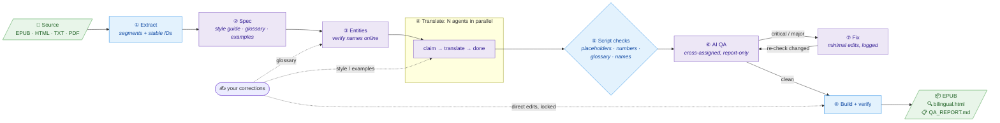

<div align="center">

# 📚 bth: book translation harness

**Translate whole books with AI agents and keep them consistent from page one to the index.**

Any language pair · Any agent runtime · EPUB in, EPUB out · You can correct anything, down to a single sentence


</div>

---

Ask an LLM to translate a 300-page book chunk by chunk and you get **three spellings of the same name**, **broken footnote links**, **an untranslated index**, and **no way to find the paragraph a reader complained about**.

`bth` splits the job in two. **Agents do the language work:** the translation spec, name verification, translation, review and fixes. **The harness does the rest:** it extracts the book, plans parallel work, validates and merges every output, runs the checks, and builds the finished EPUB.

```text
$ bth next books/my-book
{ "action": "dispatch", "phase": "translate", "pending": 64, "workers": 10 }
```

Your agent starts 10 parallel workers. Every output is checked before it is merged. When `bth next` says `done`, you have an EPUB, a side-by-side bilingual review page, and a QA report.

**You keep the final word.** Change a term, adjust the voice, or rewrite a sentence. `bth` redoes only the paragraphs your change affects, and it never overwrites your edits.

## ✨ What it does

| | |
|---|---|
| 🧭 **Spec before translation** | Before any translating, an agent writes a style guide (book background and a summary of every chapter), a glossary that handles words with several senses (*policy*: 策略 in RL, 政策 in public affairs), and example translations that set the voice. |
| 🔎 **Online name verification** | Agents look up established renderings of people, works and organisations: Wikidata first, then national sources. They also check whether the book already has a published translation, whose title and terms then take priority. |
| ⚡ **Parallel and safe** | Work is claimed atomically, so N workers can run at once. Each output is validated before it is merged under a lock. Bad output is sent back to the same worker with the exact errors. |
| 🧪 **Two layers of QA** | **Script checks:** placeholders, numbers (`3,000,000 = 300万 = 3 million`), glossary terms and forbidden variants, punctuation, name consistency, length outliers. **AI review:** a different worker reports issues by severity (critical / major / minor) without editing anything; a fixer then makes minimal edits, and every change is logged. |
| 🎨 **Original layout preserved** | Translations are written back into the source XHTML. CSS, images, footnote links, index locators and the navigation all survive. TXT, HTML and PDF sources get a clean generated EPUB. |
| 🌍 **Language rules in data, not code** | Language packs (`bth/langs/*.toml`) and pair profiles (`bth/pairs/*.md`) cover punctuation, quotes, number formats, transliteration, right-to-left and vertical layout, and navigation labels. To add a language, add a file. |
| ✍️ **You stay in control** | Correct the translation at any level: fix a term in the glossary, reshape the voice through the style guide and examples, or rewrite a sentence directly. `bth` finds the paragraphs affected and redoes only those. Your edits are locked and **never overwritten**. The QA report and bilingual page point you to the passages most worth your attention. |
| 🧾 **Every paragraph traceable** | Every paragraph has a stable ID (`ch05-p0031`), plain-text files and git commits for each phase. A reader reports an error, you fix that one paragraph, rebuild, and release again. |

## 🔁 The pipeline



<sub>🟪 agent phases · 🟦 deterministic harness steps · 🟩 inputs and outputs</sub>

`bth next` runs this whole graph. It does the blue steps itself, dispatches the purple ones to your agents, takes your corrections at any point, and won't move past a gate that hasn't passed: extraction coverage, structural validity, and no unresolved critical issues.

## 🔬 A look inside

**Everything is plain text.** Each paragraph is a segment, and inline markup becomes numbered placeholders that must survive translation:

```text
original/ch03.md                                   translation/ch03.md
<!-- ch03-p0018 p -->                              <!-- ch03-p0018 p src=562896fc mt=1d45b99e by=w4 -->
Beer liked to say that {{1}}the purpose            比尔常说，{{1}}一个系统的目的就是它所做的事{{/1}}。{{2/}}
of a system is what it does{{/1}}.{{2/}}
```

`src=` detects a changed source, `mt=` detects human edits, and `by=` lets QA avoid reviewing a worker's own output.

**QA reports issues; it never rewrites:**

```json
{"id": "ch10-p0021", "severity": "major", "category": "mistranslation",
 "src": "had been disenfranchised", "tgt": "游离于政治之外",
 "suggestion": "被排斥在政治之外",
 "rationale": "The passive sense was lost: being shut out became choosing to leave."}
```

**`review/QA_REPORT.md`** gives:
- counts and fix rates by severity;
- high-risk segments;
- a stratified, reproducible spot-check sample;
- suspected **errors in the original book**;
- glossary rows still waiting for verification.

**`dist/bilingual.html`** shows source, translation, QA notes and back-translation side by side, with an anchor for every segment ID.

## 🚀 Quick start

```bash
git clone https://github.com/Mukosame/book-translation-harness.git && cd book-translation-harness
pip install -e .              # Python ≥ 3.11 (dependency: lxml)
pip install pymupdf           # only for PDF sources

bth init books/my-book --source my-book.epub --from en --to zh-Hans --locale zh-Hans-CN
```

Then tell your agent:

> *Translate `books/my-book` with bth. Follow AGENTS.md.*

Or drive it yourself:

```bash
bth next   books/my-book                              # what's next? (JSON)
bth claim  books/my-book --phase translate --worker w1
bth done   books/my-book translate-r1-001
bth check  books/my-book                              # deterministic checks
bth build  books/my-book                              # EPUB + bilingual HTML
bth impact books/my-book --terms "policy"             # after editing the glossary
```

## ✍️ Correct and steer at any level

The agents translate the whole book; you decide what is right. Every correction is a small, targeted change that `bth` carries through the book for you:

| You want to change… | Edit | Run | What happens |
|---|---|---|---|
| how one term is rendered | `glossary.csv` | `bth impact --since <rev>` | only the paragraphs containing the term are revised |
| the voice, register or form of address | `style_guide.md` / `examples.md` | `bth plan … translate --chapters ch05` | try it on one chapter, compare, then widen the scope |
| one specific sentence | `translation/chNN.md` | `bth next` | the paragraph is locked, and machine passes never touch it again |
| a rule for a whole language | `bth/langs/<tag>.toml` | `bth build` | every book in that language benefits |

## 🌍 Languages

| Shipped | |
|---|---|
| Language packs | `en`, `zh-Hans` |
| Pair profiles | `en → zh-Hans` |

**Every pair works, given a language pack for the target.** Packs cover typography, number formats, naming standards, layout (RTL, vertical), index collation and navigation labels. Pair profiles add the pair's typical pitfalls. Packs are reviewed once by a native speaker and then reused for every book.

To add a language, copy `bth/langs/zh-Hans.toml` and fill in every key ([guide](docs/SOP.md#appendix-adding-a-language)). **Language packs and pair profiles are the most valuable contributions.**

## 📂 Project layout

```text
books/my-book/
├── book.toml          # languages, title, options (workers, QA rounds, …)
├── original/          # extracted source, one file per chapter
├── translation/       # translations, same IDs
├── style_guide.md     # book background, chapter summaries, decisions
├── glossary.csv       # terms · names · works (context, forbidden variants, evidence)
├── examples.md        # translations that set the voice
├── review/            # QA issues, fix logs, QA_REPORT.md
└── dist/              # my-book.zh-Hans.epub · bilingual.html
```

## 🧱 Design notes

- **Small on purpose.** About 1,500 lines of Python; the only required dependency is lxml. Code is managed with the [ponytail](https://github.com/DietrichGebert/ponytail) rules: reuse before adding, a test for every non-trivial piece of logic, and known limits marked `shortcut:` in the code.
- **Built from practice.** The method comes from translating two complete non-fiction books (a PDF and an EPUB) with parallel agents, including a full review pass and online verification of names. [`docs/SOP.md`](docs/SOP.md) explains every gate and why it exists.
- **Known limits:**
  - the index is not re-sorted by target-language collation;
  - PDF headings come from font-size heuristics;
  - token counts are estimates;
  - file locking is POSIX-only.

## 📖 Docs

- [`AGENTS.md`](AGENTS.md): the operational contract for agents.
- [`docs/SOP.md`](docs/SOP.md): the method, gates, quality tiers and rationale.
- [`skills/book-translation/SKILL.md`](skills/book-translation/SKILL.md): Claude Code skill.

## ⚖️ License

MIT. Only translate books you have the right to translate.
