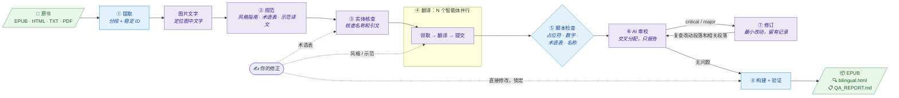

<div align="center">

# 📚 bth：整书翻译框架

[English](README.md) · **简体中文**

**用 AI 智能体翻译整本书，从第一页到索引都保持一致。**


</div>

https://github.com/user-attachments/assets/c4ba3086-4896-4ccc-a9ce-47a7110ecf2b

---

让大模型一块一块地翻译一本 300 页的书，结果往往是：**同一个名字出现三种译法**，**脚注链接失效**，**索引没有翻译**，读者指出一处错误，**你却找不到是哪一段**。

`bth` 把工作分成两半。**语言工作交给智能体：**制定翻译规范、核查名称、翻译、审校和修订。**其余的交给框架：**提取书籍内容、规划并行任务、校验并合并每一份输出、运行检查，最后构建出成品 EPUB。

```text
$ bth next books/my-book
{ "action": "dispatch", "phase": "translate", "pending": 64, "workers": 10 }
```

你的智能体启动 10 个并行 worker。每份输出合并前都要先通过校验。等 `bth next` 返回 `done`，你就得到一本 EPUB、一个双语对照审阅页面和一份 QA 报告。

**最终决定权在你。**改一个术语、调整文风，或者重写一句话，`bth` 只重做受影响的段落，而且永远不会覆盖你的修改。

## ✨ 功能

| | |
|---|---|
| 🧭 **先定规范，再动笔** | 正式翻译之前，智能体先写好风格指南（全书背景和每章摘要）、能处理一词多义的术语表（*policy* 在强化学习里译"策略"，在公共事务里译"政策"），以及定下文风的示范译文。 |
| 🔎 **在线核查名称** | 智能体查找人名、作品名和机构名的通行译法：先查 Wikidata，再查各国权威来源。还会查这本书是否已有出版的译本；如果有，就优先采用其书名和术语。 |
| ⚡ **并行且安全** | 任务以原子方式领取，N 个 worker 可以同时工作。每份输出都先校验，再在锁保护下合并。不合格的输出会连同具体错误退回给原 worker。 |
| 🧪 **两层 QA** | **脚本检查：**占位符、数字（`3,000,000 = 300万 = 3 million`）、术语表用词和禁用译法、标点、名称一致性、长度异常。**AI 审校：**由另一个 worker 按严重程度（critical / major / minor）报告问题，自己不改任何内容；随后由修订者做最小改动，每处改动都有记录。 |
| 🖼️ **图里的文字也翻译** | 存成图片的图表、示意图和表格不会被跳过。能看图的智能体会定位并转录每个标签；这些标签和正文一样经过翻译、检查和审校，然后**原位替换回图中**。想用自己重绘的图？放进去就能替换原图。 |
| 🩹 **原书错误，统一处理** | 原书中写错的人名、日期或书名，可以照原文保留、明显笔误时直接改正，或改正并加译者注。在 `book.toml` 里选一种，所有智能体都按同一标准执行。选择加注时，EPUB 会附一页"译者勘误"，每条都链接回改正过的段落。 |
| 📜 **引文追溯原文** | 书中引用外语作者的话时，智能体会查找原文并注明出处。核实过的引文采用作者原话；未能核实的会加标注，绝不冒充原文。书名、引文和重复出现的段落，在全书各处译法完全一致。 |
| 🎨 **保留原书版式** | 译文写回原书的 XHTML，CSS、图片、脚注链接、索引页码和目录导航全部保留。TXT、HTML 和 PDF 来源会生成一本干净的 EPUB。 |
| 🌍 **语言规则是数据，不是代码** | 语言包（`bth/langs/*.toml`）和语言对配置（`bth/pairs/*.md`）涵盖标点、引号、数字格式、音译、从右到左和竖排版式，以及导航标签。新增一种语言，只需新增一个文件。 |
| ✍️ **一切由你掌控** | 可以在任何层面修正译文：在术语表里改一个术语，通过风格指南和示范译文调整文风，或者直接重写一句话。`bth` 会找出受影响的段落，只重做这些段落。你的修改会被锁定，**永远不会被覆盖**。QA 报告和双语页面会指出最值得你看的段落。 |
| 🧾 **每段都可追溯** | 每个段落都有稳定的 ID（`ch05-p0031`），所有内容都是纯文本文件，每个阶段都有 git 提交。读者报告一处错误，你只改那一段，重新构建，再次发布。 |

## 🔁 流程



<sub>🟪 智能体阶段 · 🟦 框架的确定性步骤 · 🟩 输入和输出</sub>

整张图由 `bth next` 驱动：蓝色步骤由它自己完成，紫色步骤分派给你的智能体，你随时可以介入修正。关卡没通过就不会往下走，关卡包括：提取覆盖率、结构有效性，以及没有未解决的严重问题。

## 🔬 内部一览

**一切都是纯文本。**每个段落是一个片段，行内标记会变成带编号的占位符，翻译时必须原样保留：

```text
original/ch03.md                                   translation/ch03.md
<!-- ch03-p0018 p -->                              <!-- ch03-p0018 p src=4ec87897 mt=45657944 by=w4 -->
Turing asked a simple question:                    图灵提出了一个简单的问题：{{1}}机器能思考吗{{/1}}？{{2/}}
{{1}}can machines think{{/1}}?{{2/}}
```

`src=` 用来发现原文变动，`mt=` 用来发现人工修改，`by=` 让 QA 不会去审 worker 自己的译文。

**QA 只报告问题，从不改写：**

```json
{"id": "ch10-p0021", "severity": "critical", "category": "negation",
 "src": "not unlike a market", "tgt": "不像市场",
 "suggestion": "与市场颇为相似",
 "rationale": "The double negative was read as a plain negative, which reverses the meaning."}
```

**`review/QA_REPORT.md`** 包括：
- 各严重程度的问题数量和修复率；
- 高风险片段；
- 分层、可复现的抽检样本；
- **原书中的错误**，以及每处是已改正还是照原文保留；
- 仍待核实的术语表条目；
- 所有含文字的图片，以及是否已被替换。

**`dist/bilingual.html`** 把原文、译文、QA 意见和回译并排展示，每个片段 ID 都有锚点。

## 🚀 快速开始

```bash
git clone https://github.com/Mukosame/book-translation-harness.git && cd book-translation-harness
pip install -e .              # Python ≥ 3.11（依赖：lxml）
pip install pymupdf           # 仅 PDF 来源和图片预览需要

bth init books/my-book --source my-book.epub --from en --to zh-Hans --locale zh-Hans-CN
```

然后告诉你的智能体：

> *Translate `books/my-book` with bth. Follow AGENTS.md.*（用 bth 翻译 `books/my-book`，按 AGENTS.md 操作。）

也可以自己手动驱动：

```bash
bth next   books/my-book                              # 下一步做什么？（JSON）
bth claim  books/my-book --phase translate --worker w1
bth done   books/my-book translate-r1-001
bth check  books/my-book                              # 确定性检查
bth build  books/my-book                              # EPUB + 双语 HTML
bth impact books/my-book --terms "policy"             # 修改术语表之后
bth preview books/my-book                             # 把翻译后的图片渲染成 PNG
```

## ✍️ 在任何层面修正和引导

智能体负责翻译整本书，你决定什么是对的。每次修正都是一个小而精确的改动，`bth` 会替你把它贯彻到全书：

| 你想改… | 修改 | 运行 | 结果 |
|---|---|---|---|
| 某个术语的译法 | `glossary.csv` | `bth impact --since <rev>` | 只修订含有该术语的段落 |
| 文风、语域或称呼方式 | `style_guide.md` / `examples.md` | `bth plan … translate --chapters ch05` | 先在一章上试，对比之后再扩大范围 |
| 某一句话 | `translation/chNN.md` | `bth next` | 该段落被锁定，之后机器不会再改动 |
| 图表里的一个标签 | `translation/chNN.md`（对应的 `fig` 片段） | `bth build` | 新译文会放进图里 |
| 整张图 | 把重绘的图存到 `figures/` | `bth build` | 替换原图 |
| 一段引文 | `quotes.csv` | `bth impact --terms …` | 所有出现处都采用核实过的译文 |
| 关于原书错误的译者注 | `errata.csv`（改写措辞，或把 `status` 设为 `omit`） | `bth build` | 勘误页或正文内的译者注随之更新 |
| 某种语言的通用规则 | `bth/langs/<tag>.toml` | `bth build` | 这种语言的所有书都受益 |

## 🌍 语言

| 已内置 | |
|---|---|
| 语言包 | `en`、`zh-Hans` |
| 语言对配置 | `en → zh-Hans`、`zh-Hans → en` |

**只要有目标语言的语言包，任何语言对都能用。**语言包涵盖排版规范、数字格式、译名规范、版式（从右到左、竖排）、索引排序和导航标签。语言对配置补充该语言对的常见误译。语言包由母语者审核一次，之后每本书都能复用。

新增一种语言：复制 `bth/langs/zh-Hans.toml`，填好每一项（[指南](docs/SOP.md#appendix-adding-a-language)，英文）。**语言包和语言对配置是最有价值的贡献。**

## 📂 项目结构

```text
books/my-book/
├── book.toml          # 语言、书名、选项（worker 数、QA 轮数……）
├── original/          # 提取出的原文，每章一个文件
├── translation/       # 译文，ID 与原文相同
├── style_guide.md     # 全书背景、章节摘要、翻译决定
├── glossary.csv       # 术语 · 人名 · 作品名（语境、禁用译法、依据）
├── examples.md        # 定下文风的示范译文
├── quotes.csv         # 引文及其原文和出处
├── errata.csv         # 有记录的原书错误更正
├── figures/           # 可选：替换原图的翻译版图片
├── review/            # QA 问题、修订日志、QA_REPORT.md
└── dist/              # my-book.zh-Hans.epub · bilingual.html
```

## 🧱 设计说明

- **刻意保持小巧。**约 2,400 行 Python，唯一的必需依赖是 lxml。代码按 [ponytail](https://github.com/DietrichGebert/ponytail) 规则维护：先复用再新增，每段不简单的逻辑都有测试，已知局限在代码里用 `shortcut:` 标出。
- **来自实践。**这套方法来自用并行智能体完整翻译两本非虚构书籍（一本 PDF、一本 EPUB）的经验，包括一轮完整审校和名称在线核查。[`docs/SOP.md`](docs/SOP.md)（英文）解释了每道关卡及其存在的理由。
- **已知局限：**
  - 索引不会按目标语言的排序规则重新排序；
  - PDF 的标题靠字号启发式识别；
  - 图中文字是盖在纯色背景上的，所以照片上的标签需要你自己处理；
  - token 数量是估算值；
  - 文件锁只支持 POSIX 系统。

## 📖 文档

以下文档均为英文：

- [`AGENTS.md`](AGENTS.md)：给智能体的操作约定。
- [`docs/SOP.md`](docs/SOP.md)：方法、关卡、质量等级及其理由。
- [`skills/book-translation/SKILL.md`](skills/book-translation/SKILL.md)：Claude Code 技能。

## ⚖️ 许可

MIT。请只翻译你有权翻译的书。
